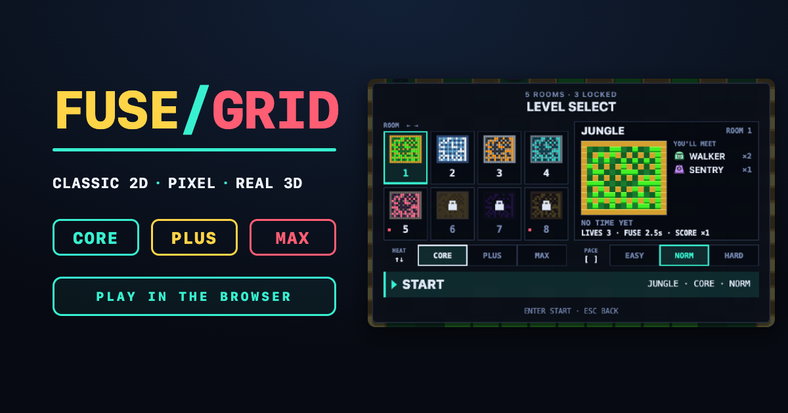

# FUSE/GRID

> **INSERT COIN.** Light the fuse, clear the room, don't stand in the blast.

**Fusegrid** is a single-player bomb-grid arcade you play right in your browser.
Flip **REAL 3D ⇄ CLASSIC 2D** (or hand-pixelled **PIXEL**) whenever you like, dial
the **Heat** to CORE, PLUS or MAX, and blow your way through eight rooms of
bricks, foes and chiptune.

[](https://github.com/HMarzban/fusegrid/actions/workflows/pages.yml)
[](LICENSE)
[](https://hmarzban.github.io/fusegrid/)

[](https://hmarzban.github.io/fusegrid/)

### ▶ PRESS START: [hmarzban.github.io/fusegrid/](https://hmarzban.github.io/fusegrid/)

No install needed, no account, no server. Just press start.

> **Sharing the link?** Keep the **trailing slash**:
> `https://hmarzban.github.io/fusegrid/`. The no-slash redirect drops the
> Open Graph tags, so chat apps show no preview card (`og.png`, 1200×630).

---

## 🕹️ How to play

**The one rule:** clear every enemy in the room to advance.

- Gold **WALL** never breaks. Green **BRICK** breaks, and stops a normal blast.
- Floor cubes lie in the open and hide under bricks: more bombs, longer
  flames, kick, throw, remote, shield and more. Grab them.
- Take a hit and you lose a heart, but the room keeps going. Any bombs and
  blades already lit stay lit, so step lively.

### Controls

| Input | Action |
|---|---|
| WASD / arrows | Move |
| Space (or J / X) | Place bomb |
| Shift + Space | Throw *(needs THROW)* |
| Q | Detonate remote *(needs REMOTE)* |
| K + move | Kick *(needs KICK)* |
| R *(in a run)* | Reset the camera and zoom |
| P / Esc | Pause (RESUME / RESTART / OPTIONS / QUIT TO MENU); ↑↓ + Enter pick a row |
| M *(paused)* | Quit to menu |
| Space / Enter *(end screen)* | Next room, back to the menu after the finale, or a new run after GAME OVER |
| C *(end screen or STATS)* | Copy your result or your stats as text (both say COPIED, or COPY FAILED) |
| B *(end screen)* | Copy the board's challenge link (the end screen says BOARD LINK COPIED) |
| T *(STATS)* | Open the MEDALS page |
| R, R *(STATS)* | Reset my cabinet (two presses; any other key cancels) |

Menus run on the arrows, Enter and Esc. Powers marked `*` in the in-game
HOW TO need their pickup first.

**On a phone or tablet,** a virtual D-pad and bomb button sit off the board.
In portrait they dock low in the thumb zone (the board centres on the menus and
slides up under the pause button during a run). In landscape they sit in the
side gutters, with pause above. Holding THROW or REMOTE? A matching button pops
up beside the bomb button (in the right gutter in landscape). STATS's MEDALS,
Copy and Reset labels are tappable too.

Want the full cast of pickups and foes? Open **GUIDE → ITEMS / ENEMIES** in the
game. The cabinet explains itself, and its wording comes straight from the
game's own item table, so it's never out of date.

---

## 🗺️ The run

### Eight rooms

| Room | Look | Notes |
|---|---|---|
| 1 | JUNGLE | Bright grass, gold stumps |
| 2 | ICE | White cubes, navy cliffs |
| 3 | FACTORY | Amber crates, steel |
| 4 | WATER | Teal sewer / ruins |
| 5 | ARENA | Night court, rose bricks. **Finale on your first run** |
| 6 | SAND | Ochre dunes *(unlocks after your first CLEAR)* |
| 7 | VOID | Violet dark, tall cliffs *(unlocks after your first CLEAR)* |
| 8 | CROWN | Gold court. **Finale after unlock** *(unlocks after your first CLEAR)* |

Every room has its own chiptune theme and its own blast tint. Fresh installs
show rooms 1–5 only. That's the gate, not a bug: beat room 5 and the map grows.

### Turn up the Heat

On LEVEL SELECT, `←/→` picks the room, `↑/↓` picks Heat and `[`/`]` picks pace
(EASY / NORM / HARD). Enter starts, Esc backs out.

| Heat | What changes |
|---|---|
| **CORE** | The baseline run (baseline v6, the replay reference) |
| **PLUS** | Harder spawns and a tighter fuse |
| **MAX** | Highest pressure |

The attract demo always runs CORE with Pact off, whatever you picked last.

### Seal a Pact *(after your first FUSE/GRID CLEAR)*

Clear room 5 once and LEVEL SELECT also offers four optional **Pact** toggles,
each a voluntary handicap:

| Key | Pact | Rule |
|---|---|---|
| `1` | LAST | Start with one life |
| `2` | BARE | No walkable floor cubes |
| `3` | THIN | One fewer buried cube under breakables |
| `4` | SHRINK | Arena walls close inward over time |

`5` adds **TIME ATTACK**: a play-only stopwatch with a per-room best. A CORE run
with every Pact off is bit-identical to baseline v6.

### Score

The live HUD shows raw points. **HIGH SCORES** saves Heat-scaled totals:
CORE ×1, PLUS ×2, MAX ×3.

---

## ✨ What's in the cabinet

- **The opening.** A FUSE/GRID title waits for any key or tap. That press drops
  the music and a ~4 s show that blasts the menu open. Any key skips it.
- **Three looks, one game.** **OPTIONS → RENDER** cycles CLASSIC 2D (Canvas),
  PIXEL (hand-drawn sprites over the same board) and REAL 3D (WebGL), live, no
  reload. REAL 3D frames the whole board from one 3/4 camera; wheel or pinch to
  zoom, and zoom snaps back to your CAMERA preset every room. OPTIONS also
  holds music and SFX volume, the 3D camera preset, brightness, screen shake
  and reduce-flash.
- **GRAPHICS.** One page (under OPTIONS, and in the pause menu) for look versus
  frame rate: QUALITY BATTERY / AUTO / HIGH in one press, or tune FRAME RATE
  (30 / 60 / MAX), RESOLUTION, SHADOWS, ANTI-ALIAS, EFFECTS, DEMO and an FPS
  METER yourself (CUSTOM). Game speed never changes. Menus and pause idle at
  30 fps, and audio sleeps while the tab is hidden.
- **Pickups that talk back.** Every pickup floats a label with your new value
  (`FLAME 4`, `MAX`, or `replaces …` on a bomb swap) and pulses its HUD chip.
  An ability bar along the bottom of the board lists the powers you hold.
- **Coach.** A ghost demonstrates your first bomb on a fresh install, then you
  get one short tip the first time you grab KICK, THROW, REMOTE, PASS, LINE,
  POWER, PIERCE or SHIELD. Once each, ever.
- **Run summary.** GAME OVER and the finale show your tally and a delta
  against your saved best for that Heat: NEW BEST, FURTHEST ROOM YET, MATCHED,
  or how far short you fell. Combo callouts and a close-call flash fire during
  play (both respect reduce-flash).
- **DAILY.** One board a day, seeded from the date. Your tries and your best
  for the day stay on this device. Nobody is ranked; it's you against you.
- **Challenge code.** On the end screen, `B` copies a twelve-character board
  code (seed, Heat, Pact, pace, never a score). Open
  `…/fusegrid/?code=XXXXXXXXXXXX` to play that same board.
- **Ghost.** Clear a room faster than ever and replaying that exact board
  (same seed, room, Heat, Pact, pace) races a translucent copy of your best
  route, in every look.
- **STATS.** Lifetime runs, rooms, deaths, kills, pickups, play time, DAYS
  PLAYED and your CORE / PLUS / MAX bests. `C` (or a tap on `C COPY MY STATS`)
  copies it as text. HIGH SCORES carries four local plaques.
- **Medals.** Eight of them, each earned on a finale clear. `T` (or a tap on
  `T MEDALS`) on STATS opens the MEDALS page.
- **Reset my cabinet.** On STATS press `R` twice (or tap `R RESET`, then
  `R AGAIN`) to wipe progress and reload. Settings and pace are kept. Anything
  else cancels (`C`, or a tap on `C COPY`, cancels and copies your stats).
- **Help on the cabinet.** **GUIDE** (HOW TO, ITEMS, ENEMIES), HIGH SCORES,
  STATS and **SOURCE**, which opens this repository.
- **Plays offline.** Install it from the browser as a PWA. After your first
  online visit it runs offline.

Everything the game remembers lives in your browser's local storage. There is
no account, no server and no global ranking.

---

## 📲 Install

- **Browser:** [hmarzban.github.io/fusegrid/](https://hmarzban.github.io/fusegrid/)
- **As an app (PWA):** use *Install app* or *Add to Home Screen* in a
  supporting browser. The first visit precaches the game and needs network;
  every visit after that works offline. (iOS: Add to Home Screen, 16.4+.)

---

## 🛠️ Build it yourself

No bundler, no build step and zero npm runtime dependencies. It's plain ES
modules, and Three.js r160 is vendored for REAL 3D only. You need **Node.js 26**.

```bash
git clone https://github.com/HMarzban/fusegrid.git rollblock
```

```bash
npm start
```

Then open `http://127.0.0.1:8080/index.html`. Run the whole test suite with:

```bash
npm test
```

Under the hood the simulation is deterministic: same seed, same inputs, same
outcome, in Node and in the browser. Read on:

| You want to… | Go to |
|---|---|
| Set up, use URL flags, send a pull request | [CONTRIBUTING.md](CONTRIBUTING.md) |
| Understand how the game works and why | [docs/architecture.md](docs/architecture.md) |
| Find any doc (and which one owns which fact) | [docs/README.md](docs/README.md) |
| See what changed in each release | [CHANGELOG.md](CHANGELOG.md) |
| Grab store art or zip the game for itch | [media/README.md](media/README.md) (listing art lives in `media/`) |
| Report a security issue | [SECURITY.md](SECURITY.md) |

Everyone in the arcade follows the [Code of Conduct](CODE_OF_CONDUCT.md).

---

## 📜 License

MIT. See [`LICENSE`](LICENSE). Three.js r160 is vendored under MIT in
`vendor/three.module.js`.

**Source:** [github.com/HMarzban/fusegrid](https://github.com/HMarzban/fusegrid).
The public game is Fusegrid; a local checkout is conventionally named
`rollblock`.

**GAME OVER?** Press Space. One more run.
