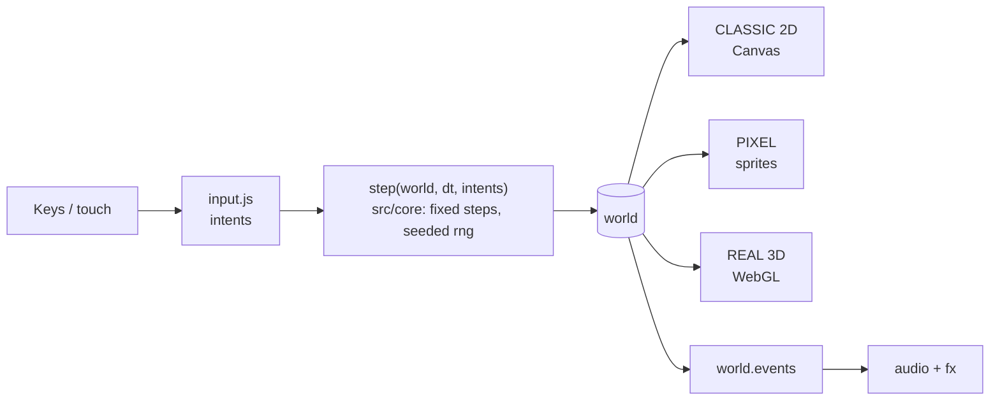

# How Fusegrid works

> **BEHIND THE CABINET.** Unscrew the back panel: one simulation, three looks,
> and every trade-off we made to keep it fast, fair and replayable.

Fusegrid runs as static ES modules with no build step and no npm runtime
dependencies. The browser owns input and presentation. The simulation is
importable directly in Node, so the game's rules can be tested without a
browser at all.

New here? Start with [CONTRIBUTING.md](../CONTRIBUTING.md) to get it running.
For the binding rulebook (pinned numbers, test contracts, owner rulings), see
[AGENTS.md](../AGENTS.md). This page explains *how* and *why*.

---

## 🎮 Level 1: one simulation, three looks

[`src/main.js`](../src/main.js) collects intents, advances an accumulator in
fixed [`CFG.STEP`](../src/core/config.js) increments, and renders the resulting
world. [`step`](../src/core/sim.js) changes that world using seeded randomness
from [`rng.js`](../src/core/rng.js), with no DOM and no wall clock in the core.
That's the whole trick: a recorded seed plus an input sequence replays exactly,
without ever starting a browser.

Three renderers read the same simulation state, and the OPTIONS RENDER row
cycles them: CLASSIC 2D (Canvas 2D, the default), PIXEL (hand-pixelled sprites)
and REAL 3D (WebGL). Three.js is vendored and loaded only for REAL 3D. Keeping
rendering separate means a visual change can't change the game's rules, though
GPU output and visual readability still need checking in a real browser. The
shell state machine owns the menus; pause, win and loss belong to the world.

The menu pages follow one layout idea, **pick on the left, see it on the
right**. LEVEL SELECT is a grid of room tiles beside a room card that shows
the world, the foes you'll meet, your best time and what the heat changes.
On a keyboard the main menu is a list beside a preview that follows the
cursor; on a phone it's a hub of tiles. Every panel is only as tall as its
content, and any teaser built from your record (a top score, a best time)
reads only runs you played, never placeholders.

The build you're running is named on the main menu (`v185` today): in the
keyboard foot hint, under the phone hub, or on the SOURCE tile where a
landscape touch screen has no room below the hub. OPTIONS shows it as its
`BUILD` kicker and the NEW VERSION READY card says which build you're on.
There is one source for it: `shellview.js` and `update.js` both derive it
from `CACHE_NAME` in [`shell.js`](../src/pwa/shell.js), so a release bump
renames it everywhere at once.

Every menu is drawn by one small kit in
[`menudraw.js`](../src/render/menudraw.js): one panel (`plate`), one title
(`head`), one hint line (`foot`) and one row painter (`paintRow`), so the
selected row is the same object on the main menu, the pause menu, OPTIONS,
GRAPHICS and GUIDE. A list is laid out by `listGeom` and tapped through
`listHit` from that same table, so a tap always lands on the row it looks
like. The pause menu borrows the kit from [`scenes.js`](../src/render/scenes.js)
instead of keeping its own look. Touch follows one rule everywhere: a tap on a
row is Enter on it, and a tap off the rows does nothing on the main menu or
the pause list and backs out of any other page. A chip tap on LEVEL SELECT or
HIGH SCORES goes through the same app call as its arrow key, so it sounds the
same.

A portrait phone sizes the board by its width, which left the menus at about
0.63 scale in a third of the screen. So on a portrait phone the main menu and
every menu page draw on their own canvas, `#sh`, laid over the whole viewport
at about 0.9 scale ([`fit.js`](../src/app/fit.js) `shellGeo`). The board
canvases never see that box: they keep their own size and position, so no
renderer changes and the board still sits behind the menu with the logo on
it. The box is narrower than 600, so pages re-flow there (LEVEL SELECT stacks
its room card under the grid, MEDALS goes to one column). `fit.shell` hands
the drawing code and the tap handler the same logical box, so a tap still
lands where it is drawn. The intro, attract mode, play and the pause menu stay
on the board canvas.

The 3D renderer works to a fixed budget of 500 draw calls, and the tests' fully
populated room draws 141. Anything repeated is instanced, so cost doesn't grow
with what's on screen. Every live blast shares two draws in
[`blast.js`](../src/render/three/blast.js): an additive danger plate on each
deadly tile, which tells the same tile-accurate truth as the 2D square, and one
batch of shader-shaded fireballs that adds volume on top of it.

## 👾 Level 2: PIXEL, sprites without a second game

PIXEL is its own renderer factory in
[`src/render/pixel/`](../src/render/pixel/), built beside the 3D wrapper rather
than as a branch of the classic renderer. That keeps CLASSIC 2D byte-for-byte
what it was (a call-log hash in the tests pins it). Every sprite is a small
text grid whose characters name palette slots, never colours, and every colour
a slot resolves to is a hex the repository already uses. A
[manifest](../src/render/pixel/manifest.js) derives the list of cells the look
needs from the game's own foe, pickup and biome tables. So a new foe without
art shows a visible placeholder and a test fails, instead of the gap slipping
through silently. The art is baked into images the first time PIXEL is chosen,
never at boot.

The board is drawn at its native 300×260 art pixels, scaled up by
nearest-neighbour to a whole multiple, then scaled once more, with smoothing,
to the screen. That two-step "sharp-bilinear" blit keeps the board the same
size as in the other looks on any screen, while keeping each art-pixel edge
within one device pixel of sharp at normal zoom (a strong pinch zoom softens it
slightly). The camera and the intro zoom reach PIXEL through the overlay
canvas's transform, so PIXEL needs no camera code of its own. Animation runs on
clocks the renderer owns, and they stop in PAUSE, so a paused board doesn't
keep walking. When PIXEL is on, the HUD item chips and the GUIDE pages show the
same cells as the board.

**The cost:** about 120 KB of JavaScript that every boot still parses, even
when PIXEL is never chosen. A test caps it. The planned follow-up is to load
the PIXEL code on demand, the way the 3D library already is.

## ⚙️ Level 3: graphics settings and frame pacing

The GRAPHICS page (from OPTIONS, or inline from PAUSE) is one model for every
look: a QUALITY preset (BATTERY, AUTO, HIGH) over FRAME RATE, RESOLUTION,
SHADOWS, ANTI-ALIAS, EFFECTS and the attract DEMO, plus an FPS meter. QUALITY
isn't stored. It's read back from the six rows, and any other mix shows as
CUSTOM. A pure policy module, [`gfx.js`](../src/app/gfx.js), turns the saved
rows and the device (layout, pixel ratio) into one set of knobs that each
renderer receives. Rows that can't affect the current look are shown locked
rather than hidden. AUTO is the default and keeps the earlier desktop look;
the cheaper options, including no shadows, exist only as choices the player
makes.

[`frameloop.js`](../src/app/frameloop.js) owns `requestAnimationFrame`. It works
out the display's refresh rate and renders every n-th frame, so 60 on a 120 Hz
panel is an even every-other frame, not uneven catch-up. The simulation still
advances in fixed steps, so the frame rate never changes game speed. Menus,
pause and the attract demo are capped lower still (30, never under 20, so
music scheduling stays safe), and any input wakes the loop at once. When
nothing on the board changes, a renderer reuses its last image instead of
redrawing it, with a forced redraw every half second as a safety net. REAL 3D
also redraws its shadow map only when something that casts a shadow moves.
PAUSE freezes the board in all three looks. On REAL 3D with automatic
resolution, a governor lowers the pixel ratio in steps when frames run long,
and raises it again after ten clean seconds.

REAL 3D draws every wall tile through one instanced mesh. It watches the
wall set as well as the bricks, so walls that appear mid-room (SHRINK
rings, since shell v183) are drawn at once, still in that one draw call.

[`rcache.js`](../src/app/rcache.js) keeps one renderer per look. Ten seconds
after the player switches away, an unused REAL 3D renderer is disposed and
PIXEL shrinks its canvases to almost nothing; CLASSIC 2D costs little to keep,
so it stays. A lost WebGL context is replaced with a new renderer.
Anti-aliasing can only be set when a WebGL context is created, so a change
takes effect as one rebuild when the player leaves the page, and the old
renderer is kept if the new context fails. [`audiopower.js`](../src/app/audiopower.js)
suspends audio while the page is hidden.

**The scoreboard:** measured in headed Chrome on a 120 Hz Mac against the
build before this work, with default settings, summed browser CPU fell by
about 56–80% on the title, menus and demo, 59–67% in PAUSE and 27–36% in play.
Phones and other GPUs were sampled only lightly, so treat these as one
machine's numbers.

## ✨ Level 4: pickup feedback

Picking something up says what changed. A short label rises from the tile with
the value after the pickup ("FLAME 3", a muted MAX at the cap, or which special
bomb a new one replaces), the matching HUD chip pulses, and a bar along the
bottom of the board lists the abilities the player is holding. When a hit
takes an ability away, its chip fades out rather than vanishing. All of the
wording comes from the same item table the ITEMS help page uses, so there's
one source for each name and help line. A one-time tip explains each of the
eight verbs that need explaining (the four plain stat pickups are covered by
the label alone). On touch layouts, THROW and REMOTE get their own buttons,
which appear only while the player has that power. These overlays run on the
play clock, freeze in PAUSE, and draw nothing at all when idle, so a quiet
frame costs the same as before.

## 📱 Level 5: browser edges, audio and touch

Browsers only start sound from a user gesture, so the game's audio context is
created inside the first press ([`unlock.js`](../src/app/unlock.js)). Until that
context is actually running, sound effects are dropped rather than queued,
because a queued sound would play late, or stacked, once the clock starts. The
first audio context a browser session creates also spends tens of milliseconds
bringing up the device, so [`audio.js`](../src/audio.js) pays that once at boot
with a throwaway context, and the first press doesn't stutter. A touch
`pointerdown` doesn't count as a gesture for these rules, so anything a tap
must unlock, such as copying STATS to the clipboard, runs on `pointerup`.

One JavaScript predicate picks the layout: [`fit.js`](../src/app/fit.js) writes
`body[data-lay]` as desktop, touch portrait or touch landscape, and the page
styles key off that rather than a CSS media query. A portrait phone has spare
height, so the stage is centred on menu screens and slides up under the pause
button during play, giving the touch controls a bigger thumb area below. The
geometry is a pure function tested in Node; how it feels in the hand still
needs a real phone.

## 🧱 The board look (shell v185)

Shell v185 (2026-10-25) gives the board a new look in all three looks. It adds:

- **New walls** per world and a quiet **base floor** under everything
  ([`wallart.js`](../src/render/wallart.js), [`floorart.js`](../src/render/floorart.js)).
- **Eight floor tiles**, one per world: hardware sunk into the floor in the built
  worlds, the ground itself changed in the living ones
  ([`featdraw.js`](../src/render/featdraw.js) and its painters in
  [`featart/`](../src/render/featart/); REAL 3D reads the same geometry table in
  one shader, [`three/featmesh.js`](../src/render/three/featmesh.js)). Only
  CONVEYOR, ICE PATCH, BOOSTER and TRAP have rules
  ([`core/feat.js`](../src/core/feat.js)); STREAM, QUICKSAND, PORTAL and GATE are
  art for now. Tiles appear only on the gen-2 boards, a test build reached with
  `?gen=2`; every normal run, challenge code and daily plays today's boards,
  and the GUIDE's FLOOR page marks the tiles PREVIEW.
- **A world bezel and a recessed well** around the board
  ([`frameart.js`](../src/render/frameart.js), [`frame.js`](../src/render/frame.js)).
- **Depth**: cast and contact shadows, ambient occlusion, lower-value bricks
  ([`depth2d.js`](../src/render/depth2d.js), [`three/groundfx.js`](../src/render/three/groundfx.js)).
- **Ambient motion** per world (motes, glints, steam, drift) from one
  deterministic spec, [`ambient.js`](../src/render/ambient.js), on a PLAY-only
  clock; ATTRACT shows it too, menus never.
- **Foe and pickup animation** from one timing spec,
  [`motion.js`](../src/render/motion.js), with
  [`entityfx.js`](../src/render/entityfx.js) turning kill and pickup events into
  death ghosts and collect bursts. Every clock freezes in PAUSE; REAL 3D uses a
  pause-corrected clock so a pause never cuts an effect short.
- **The PIXEL tree loads lazily** ([`pixel/load.js`](../src/render/pixel/load.js)),
  so CLASSIC visitors never download it.
- **GUIDE grows a FLOOR page** and its pages animate.

Budgets after the round: REAL 3D fat-world 156 draw calls (158 worst case),
PIXEL lazy tree about 159 KB of a 160 KB cap, CLASSIC call log re-pinned as
`9fb48f0a:72431`. Frame times on a real GPU are not measured yet (issue #34).
How it is put together, the rulings and what is still open live in
[one record](superpowers/specs/2026-10-25-board-look-depth-ambient-design.md);
the tile look is in the
[direction D record](superpowers/specs/2026-10-25-floor-tiles-direction-d-design.md);
the gameplay gaps are tracked in issue #35. 

## 🧪 Boss fight: evidence and limits

- [Determinism tests](../tests/determinism.test.mjs) replay mixed input over
  1,800 ticks and compare state across worlds and seeds.
- [Lockstep tests](../tests/net_lockstep.test.mjs) exercise the local
  synchronization protocol. The [`?net=local` harness](../src/net/localpair.js)
  drives two worlds, but the simulation still consumes player zero. Internet
  multiplayer would need real multiplayer simulation, session ownership,
  a disconnect/rejoin policy and network testing.
- The tests in [`tests/`](../tests/) also cover storage, menus, rendering
  contracts, PIXEL art completeness, frame pacing and graphics policy, and the
  PWA shell. `npm test` is a deployment gate; it doesn't establish visual
  correctness on every browser or GPU.

## 💾 Save game: persistence and offline play

Progress and personal records live in browser local storage. They're local to
that browser and can be cleared; there's no account and no server record.
Daily boards and challenge codes reproduce a board, not a verified score. When
STATS or a run summary copies text, the screen says COPIED or COPY FAILED only
after the clipboard has accepted or refused it.

The [service worker](../sw.js) precaches the versioned
[app shell](../src/pwa/shell.js), including the vendored 3D library. A
successful online first visit is needed before offline use. A new release
installs in the background and waits; a **NEW VERSION READY** card
([`update.js`](../src/app/update.js)) offers RELOAD (or `U`), but only on the
menus or after a finished run, never in the middle of one. Pressing it hands
control to the new worker and the page reloads once. Copies from before the
card existed (shell v178 and older) update once on their own, because their
page can't show it. Cleanup touches only this game's own caches. First-time offline
loading and syncing progress between devices are outside this design.
Play stats are opt-in Google Analytics 4 ([`analytics.js`](../src/app/analytics.js),
[privacy](privacy.md)). A consent card on the menus asks once, and OPTIONS →
ANALYTICS changes the answer. Nothing loads before ALLOW. Then `gtag.js` arrives
as a plain script tag (still zero npm deps), its cookies are scoped to the
game's own path on the shared `github.io` origin, and every ad signal is denied.
It runs only on the Pages host with a real Measurement ID; `?debug=1` elsewhere
logs the calls to `__GAME__.ga.log` instead. The opens are GA's page views;
the game adds `run_start` / `run_end` from its own world's run edges (never
attract or the intro show) and a days-played bucket from STATS. Opens are
undercounted by design: a visitor who leaves at the title, or declines, is
never counted.
The manifest's install-dialog screenshots (`screenshots/`) ship with the
site but stay out of the precache. The dialog fetches them online, and the
worker never stores a file it didn't precache.

---

**STAGE CLEAR.** Want the *why* behind a specific call? The dated records in
the [docs map](README.md#-design-history) go all the way back to day one.
