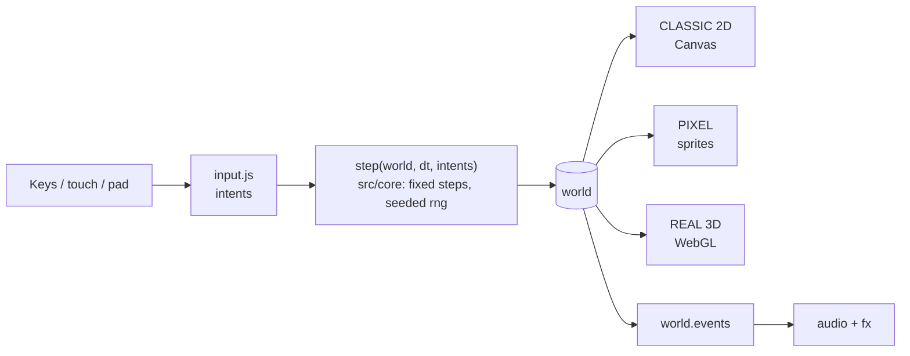

# How Fusegrid works

> **BEHIND THE CABINET.** Unscrew the back panel: one simulation, three looks,
> and every trade-off we made to keep it fast, fair and replayable.

Fusegrid runs as static ES modules with no build step and no npm runtime
dependencies. The browser owns input and presentation. The simulation is
importable directly in Node, so the game's rules can be tested without a
browser at all.

New here? Start with [CONTRIBUTING.md](../CONTRIBUTING.md) to get it running.
For the binding rulebook (pinned numbers, test contracts, owner rulings), see
[AGENTS.md](../AGENTS.md). This page explains *how* and *why*.

---

## 🎮 Level 1: one simulation, three looks

[`src/main.js`](../src/main.js) collects intents, advances an accumulator in
fixed [`CFG.STEP`](../src/core/config.js) increments, and renders the resulting
world. [`step`](../src/core/sim.js) changes that world using seeded randomness
from [`rng.js`](../src/core/rng.js), with no DOM and no wall clock in the core.
That's the whole trick: a recorded seed plus an input sequence replays exactly,
without ever starting a browser.

Three renderers read the same simulation state, and the SETTINGS ART STYLE row
cycles them: CLASSIC 2D (Canvas 2D, the default), PIXEL (hand-pixelled sprites)
and REAL 3D (WebGL). Three.js is vendored and loaded only for REAL 3D. Keeping
rendering separate means a visual change can't change the game's rules, though
GPU output and visual readability still need checking in a real browser. The
shell state machine owns the menus; pause, win and loss belong to the world.

The menu pages follow one layout idea, **pick on the left, see it on the
right**. MENU is seven rows (PLAY, LEVEL SELECT, DAILY, RECORDS, SETTINGS,
GUIDE, SOURCE) beside a next-run card that shows the world, the foes you'll
meet, the floor tile and the run's lives, fuse and score multiplier; LEVEL
SELECT is a short list of rows (LEVEL, DIFFICULTY, GAME SPEED, MODIFIERS,
START) beside the same card. On a phone both become one column, and on a
landscape phone a grid of tiles. Any teaser built from your record (a top
score, a best time) reads only runs you played, never placeholders.

The build you're running is named on the main menu (`v216` today): at the end
of the desktop foot, or on the SOURCE row's teaser on a phone. SETTINGS shows
it as its `BUILD` kicker and the NEW VERSION READY card says which build you're on.
There is one source for it: `shellview.js` and `update.js` both derive it
from `CACHE_NAME` in [`shell.js`](../src/pwa/shell.js), so a release bump
renames it everywhere at once.

Since shell v203 (the UI upgrade's first release) the menus are drawn by a
world kit in [`src/render/kit/`](../src/render/kit/): `worldTokens(level)` gives
each world its colours, `paint.js` the keys, cells, plate, the bare focus
bomb and its ring, `type.js` the system-font type scale, `room.js` the look of
the picked level behind the page (its floor only, at the size you play on, since the owner's 2026-11-14 pick), and `cache.js` an offscreen layer cache, so a
steady menu frame is a few blits plus the live focus. Each page is one module
in [`src/render/pages/`](../src/render/pages/) (MENU, LEVEL SELECT, the cards,
SETTINGS / GRAPHICS, GUIDE, RECORDS, PAUSE and the run ends) with ONE geometry
that both the painter and the tap handler read, so a tap lands where the key is
drawn. [`menudraw.js`](../src/render/menudraw.js) keeps the entry names and
delegates to them. MENU, the cards, PAUSE and the CLASSIC logo
([`logo/`](../src/render/logo/)) load at boot; LEVEL SELECT (since v214), SETTINGS, GUIDE, RECORDS and the
run ends (LEVEL CLEAR and the finale in `endwin.js`, GAME OVER in `endlose.js`,
one draw and tap contract in `endgeom.js`) load through
[`pages/lazy.js`](../src/render/pages/lazy.js) in the idle after MENU's first
frame, and draw one shared LOADING plate until they land. The logo is drawn by
one painter in every look (PIXEL's grids in `pixel/logo.js`, REAL 3D's side in
`logo/draw3d.js`, both lazy with their look), and CONTROLS draws the controller
and the keyboard you play with ([`padart.js`](../src/render/padart.js)). Player
words live in one table, [`words.js`](../src/render/words.js). Under `?debug=1`
every page can record what it drew (`kit/probe.js`), which
[`tools/ui/`](../tools/ui/) turns into captures and readability gates. On every
touch layout a target is at least 44 CSS px with 8 px between targets; where a
page cannot fit at that size it turns into pages with ▲ / ▼ keys (one pager,
`kit/pager.js`) rather than shrinking its text. Touch follows one rule everywhere: a tap on a
row is Enter on it, and a tap off the rows does nothing on the main menu or
the pause list and backs out of any other page. A chip tap on LEVEL SELECT or
SCORES goes through the same app call as its arrow key, so it sounds the
same.

The main menu and every menu page draw on their own canvas, `#sh`, laid over
the whole viewport ([`fit.js`](../src/app/fit.js) `shellGeo`). On a desktop
and a landscape tablet that box is the window at scale 1; a window under
600 × 520 (`WIN_SHELL`) has no box and keeps the menus on the board canvas, as does every
landscape phone, since a page narrower than 600 would cut its text. A
portrait phone sizes the board by its width, which left the menus at about
0.63 scale in a third of the screen, so there the box is the viewport at
about 0.9 scale; it is narrower than 600, so pages re-flow there into one
column. The board canvases never see the box: they keep their own size and
position, so no renderer changes. A page covers the board with the look of
the picked level, drawn at the board's own scale in a run (so the cells behind a
menu are the size you play on, the floor and walls running on to the window's
edges), and the renderers skip the board raster under it. Every plate centres in
its box with its foot; the old top margin is only the minimum. `fit.shell` hands the drawing code and the tap handler the same logical
box, so a tap still lands where it is drawn. The intro, attract mode and play stay on
the board canvas with `#sh` hidden. PAUSE (and its SETTINGS, GRAPHICS and CONTROLS views),
LEVEL CLEAR, the finale and GAME OVER draw on `#sh` too, in one of two ways. On a desktop and
a landscape layout `#sh` lies exactly on the board canvas's content box at device resolution
(shell v214; before, these plates were drawn into the board's 600 × 520 backing and stretched,
so they looked soft beside PIXEL and REAL 3D), click-through, and the overlay keeps the board's
own box, so its layout and taps did not move. On a portrait phone they take the whole column
under the HUD plate down to the safe area (`fit.over()`), where they no longer page or squeeze
into two columns, with the frozen board still under the veil. The run-end plates centre in that
box; they used to keep the board's top strip clear for the HUD the board no longer draws. The HUD (shell v206,
[`hud.js`](../src/render/hud.js)) draws on a fourth canvas, `#hud`, laid over the
viewport and clicked through: seven labelled chips in the level's frame above the
board on a desktop, in a grid with the PAUSE key on a portrait phone and in the
side gutters on a landscape one, never over the board. It paints only when what it
shows changes, so a still frame costs no canvas calls. A controller plugged in, back or lost
during a run shows for 3 s in the plate the floor-tile tips use (beside the board, under it on
a portrait phone, in the left gutter on a landscape one), with that controller's MOVE and BOMB
buttons; off a run the menus' note says it as before.

The 3D renderer works to a fixed budget of 500 draw calls, and the tests' fully
populated room draws 141. Anything repeated is instanced, so cost doesn't grow
with what's on screen. Every live blast shares two draws in
[`blast.js`](../src/render/three/blast.js): an additive danger plate on each
deadly tile, which tells the same tile-accurate truth as the 2D square, and one
batch of shader-shaded fireballs that adds volume on top of it.

## 👾 Level 2: PIXEL, sprites without a second game

PIXEL is its own renderer factory in
[`src/render/pixel/`](../src/render/pixel/), built beside the 3D wrapper rather
than as a branch of the classic renderer. That keeps CLASSIC 2D byte-for-byte
what it was (a call-log hash in the tests pins it). Every sprite is a small
text grid whose characters name palette slots, never colours, and every colour
a slot resolves to is a hex the repository already uses. A
[manifest](../src/render/pixel/manifest.js) derives the list of cells the look
needs from the game's own foe, pickup and biome tables. So a new foe without
art shows a visible placeholder and a test fails, instead of the gap slipping
through silently. The art is baked into images the first time PIXEL is chosen,
never at boot.

The board is drawn at its native 300×260 art pixels, scaled up by
nearest-neighbour to a whole multiple, then scaled once more, with smoothing,
to the screen. That two-step "sharp-bilinear" blit keeps the board the same
size as in the other looks on any screen, while keeping each art-pixel edge
within one device pixel of sharp at normal zoom (a strong pinch zoom softens it
slightly). The camera and the intro zoom reach PIXEL through the overlay
canvas's transform, so PIXEL needs no camera code of its own. Animation runs on
clocks the renderer owns, and they stop in PAUSE, so a paused board doesn't
keep walking. When PIXEL is on, the HUD item chips and the GUIDE pages show the
same cells as the board.

**The cost:** about 120 KB of JavaScript that every boot still parses, even
when PIXEL is never chosen. A test caps it. The planned follow-up is to load
the PIXEL code on demand, the way the 3D library already is.

## ⚙️ Level 3: graphics settings and frame pacing

The GRAPHICS page (from SETTINGS, or inline from PAUSE) is one model for every
look: a QUALITY preset (BATTERY, AUTO, HIGH) over FRAME RATE, RESOLUTION,
SHADOWS, ANTI-ALIAS, EFFECTS and the attract DEMO, plus an FPS meter. QUALITY
isn't stored. It's read back from the six rows, and any other mix shows as
CUSTOM. A pure policy module, [`gfx.js`](../src/app/gfx.js), turns the saved
rows and the device (layout, pixel ratio) into one set of knobs that each
renderer receives. Rows that can't affect the current look are shown locked
rather than hidden. AUTO is the default and keeps the earlier desktop look;
the cheaper options, including no shadows, exist only as choices the player
makes.

[`frameloop.js`](../src/app/frameloop.js) owns `requestAnimationFrame`. It works
out the display's refresh rate and renders every n-th frame, so 60 on a 120 Hz
panel is an even every-other frame, not uneven catch-up. The simulation still
advances in fixed steps, so the frame rate never changes game speed. Menus,
pause and the attract demo are capped lower still (30, never under 20, so
music scheduling stays safe), and any input wakes the loop at once. When
nothing on the board changes, a renderer reuses its last image instead of
redrawing it, with a forced redraw every half second as a safety net. REAL 3D
also redraws its shadow map only when something that casts a shadow moves.
PAUSE freezes the board in all three looks. On REAL 3D with automatic
resolution, a governor lowers the pixel ratio in steps when frames run long,
and raises it again after ten clean seconds.

REAL 3D draws every wall tile through one instanced mesh. It watches the
wall set as well as the bricks, so walls that appear mid-room (SHRINK
rings, since shell v183) are drawn at once, still in that one draw call.

[`rcache.js`](../src/app/rcache.js) keeps one renderer per look. Ten seconds
after the player switches away, an unused REAL 3D renderer is disposed and
PIXEL shrinks its canvases to almost nothing; CLASSIC 2D costs little to keep,
so it stays. A lost WebGL context is replaced with a new renderer.
Anti-aliasing can only be set when a WebGL context is created, so a change
takes effect as one rebuild when the player leaves the page, and the old
renderer is kept if the new context fails. [`audiopower.js`](../src/app/audiopower.js)
suspends audio while the page is hidden.

**The scoreboard:** measured in headed Chrome on a 120 Hz Mac against the
build before this work, with default settings, summed browser CPU fell by
about 56–80% on the title, menus and demo, 59–67% in PAUSE and 27–36% in play.
Phones and other GPUs were sampled only lightly, so treat these as one
machine's numbers.

## ✨ Level 4: pickup feedback

Picking something up says what changed. A short label rises from the tile with
the value after the pickup ("FLAME 3", a muted MAX at the cap, or which special
bomb a new one replaces), the matching HUD chip pulses, and the power-ups bar
under the board lists the abilities the player is holding. When a hit
takes an ability away, its chip fades out rather than vanishing. All of the
wording comes from the same item table the POWER-UPS help page uses, so there's
one source for each name and help line. A one-time tip explains each of the
eight verbs that need explaining (the four plain stat pickups are covered by
the label alone). On touch layouts the HUD paints a touch strip (a D-PAD of
four keys and a yellow BOMB key) and THROW and REMOTE keys that appear only
while the player has that power; the page's own buttons sit over them as
transparent hit areas. A floor tile's first-use tip stands beside the board on
a leader to the nearest tile of its kind. These overlays run on the
play clock, freeze in PAUSE, and draw nothing at all when idle, so a quiet
frame costs the same as before.

## 📱 Level 5: browser edges, audio and touch

Browsers only start sound from a user gesture, so the game's audio context is
created inside the first press ([`unlock.js`](../src/app/unlock.js)). Until that
context is actually running, sound effects are dropped rather than queued,
because a queued sound would play late, or stacked, once the clock starts. The
first audio context a browser session creates also spends tens of milliseconds
bringing up the device, so [`audio.js`](../src/audio.js) pays that once at boot
with a throwaway context, and the first press doesn't stutter. A touch
`pointerdown` doesn't count as a gesture for these rules, so anything a tap
must unlock, such as copying STATS to the clipboard, runs on `pointerup`.

One JavaScript predicate picks the layout: [`fit.js`](../src/app/fit.js) writes
`body[data-lay]` as desktop, touch portrait or touch landscape, and the page
styles key off that rather than a CSS media query. A portrait phone has spare
height, so the stage is centred on menu screens and slides up under the HUD's
chip plate during play, giving the touch strip a bigger thumb area below. The
geometry is a pure function tested in Node; how it feels in the hand still
needs a real phone.

### The input seam: keys, fingers and pads (shell v201)

**The sim never knows a pad exists.** `step()` gets the same `{move, fire, firePrev, shift, remote}` it
always got, so replays and hashes hold. A pad is one more writer into [`input.js`](../src/input.js), with
its own held axes and latches, OR-merged with keys. A held key beats the pad on a mixed axis.

- [`gamepad.js`](../src/app/gamepad.js) polls on every rAF **above** the frame gate, so a 30 FPS cap or the
  20 FPS idle floor can't lose a tap. A press holds for at least one tick. The stick has a radial deadzone and walks 4-way.
  SENSITIVITY has five levels (MIN 60, LOW 40, MEDIUM 25, HIGH 15, MAX 8 percent), each with its own release and turn
  (1.40x to 1.10x). No response curve: `step()` gets -1, 0 or 1, so stick distance never reaches the sim. On a menu the
  first engage takes vertical unless x leads y by 1.25x. A pad the browser passes in its own HID order (no `standard`
  mapping) that `gamepad.js` knows, today the Switch 2 Pro Controller, is put back in the standard order before anything
  reads it, so its D-PAD, triggers and sticks land where every other pad's do.
- [`padroute.js`](../src/app/padroute.js) decides what a press means on the current screen. A press in one
  layer is spent there, so SOUTH that starts a run plants nothing.
- [`controls.js`](../src/app/controls.js) holds the binds and their rules (`nb.controls.v1`, kept by a cabinet
  reset). [`capture.js`](../src/app/capture.js) and [`controlspage.js`](../src/app/controlspage.js) run the
  page. Capture goes first in every path, so ESC while listening never pauses the game.
- [`hints.js`](../src/app/hints.js) tracks the last-used device, and the render side reads its words through
  [`hintcopy.js`](../src/render/hintcopy.js), so render still imports nothing from `src/app/`.
- [`rumble.js`](../src/app/rumble.js) reads the event drain one way and never touches the world. The player's word for it is
  VIBRATION: OFF, LOW, MEDIUM (default) and HIGH, separate from REDUCE FLASH. Each step is one `playEffect` call, because a new call
  replaces the running one, so `tick` on every rAF walks a pattern table with priorities. Same or lower priority is dropped,
  never queued. Patterns stop at 500 ms and 3 pulses, and the per-second limits hold everything but hurt and lose. There's one
  fire function, so OFF really makes zero calls. A run and the menu ticks buzz only while the pad is the last-used device; the
  row's test pulse is the one exception. Trade-off: menu ticks have no switch of their own, since the page holds 8 rows, so LOW
  is the way to keep game vibration without them. Menu feels (launch, enter, back, deny, hello, confirm, move) are written by
  the shell call that causes them into one ranked slot (`app.feel`), armed and read around the pad poll's routing, so a press gets exactly one feel; gameplay
  preempts them, cursor ticks share 900 ms of motor per 10 s while page feels always play but count (launch and hello outside it) and they never fire alone, without a change on screen.
- A held menu direction runs its frame at up to 60 Hz ([`frameloop.js`](../src/app/frameloop.js) `HELD_FPS`, under the FRAME RATE
  cap), so a repeat no longer lands on a 20-30 FPS idle frame. The 350 then 110 ms repeat itself did not change.
- The CONTROLS page is on the world kit like every other page (Task 6.3, [`pages/controls.js`](../src/render/pages/controls.js)):
  brick tabs, the rows as kit keys and steppers, and beside them a floor slab with the drawing large and its callouts. One look to
  maintain, no second skin: the old CONSOLE PANEL kit is gone.
- [`controlswire.js`](../src/app/controlswire.js) binds all of it to `main`, the frame loop and the audio unlock.
  It retries a failed `rumble.js` load on the next controller press or a CONTROLS open.

Trade-offs: since v202 the page's paint (the page, its geometry, the drawings, the capture and vibration modules) loads
after the title, so CONTROLS can open on the kit's LOADING plate. Its taps follow the rule every lazy page follows: inert
while the files are on their way, and once they have failed (the plate reads DID NOT LOAD) a tap off the plate backs out,
so nobody is stuck on it. Keyboard diagonals stay about 1.41x while a pad is 4-way, because changing keys would alter feel
and old bests. Every pad test uses a fake pad. The owner has played on a real controller and reports it works; the details
are not in yet, so the human checks stay open, and nobody has yet confirmed vibration felt on real hardware. The
[record](superpowers/specs/2026-11-06-controls-built.md) has the rulings and the go/no-go list.

## 🧱 The board look (shell v185)

Shell v185 (2026-10-26) gives the board a new look in all three looks. It adds:

- **New walls** per world and a quiet **base floor** under everything
  ([`wallart.js`](../src/render/wallart.js), [`floorart.js`](../src/render/floorart.js)).
- **Eight floor tiles**, one per world: hardware sunk into the floor in the built
  worlds, the ground itself changed in the living ones
  ([`featdraw.js`](../src/render/featdraw.js) and its painters in
  [`featart/`](../src/render/featart/); REAL 3D reads the same geometry table in
  one shader, [`three/featmesh.js`](../src/render/three/featmesh.js)). Only
  CONVEYOR, ICE PATCH, BOOSTER and TRAP have rules
  ([`core/feat.js`](../src/core/feat.js)); STREAM, QUICKSAND, PORTAL and GATE are
  art for now. In v185 the tiles appeared only on a test build reached with
  `?gen=2`; since v188 that preview is `?gen=3` (the gen-2 board plus the
  tile layer, see below), and the GUIDE's FLOOR page marked the tiles
  PREVIEW. Since v198 every ordinary run and the DAILY play them, and the flag is gone.
- **A world bezel and a recessed well** around the board
  ([`frameart.js`](../src/render/frameart.js), [`frame.js`](../src/render/frame.js)).
  In REAL 3D the bezel is one extruded rim ([`three/rimart.js`](../src/render/three/rimart.js)) whose outer edge is a plain
  rectangle: the near corners used to lean in to stay on screen at the default zoom, which read as a flared tray once the
  camera pulled back (v214), so now they run off the bottom of the screen at the default zoom instead.
- **Depth**: cast and contact shadows, ambient occlusion, lower-value bricks
  ([`depth2d.js`](../src/render/depth2d.js), [`three/groundfx.js`](../src/render/three/groundfx.js)).
- **Ambient motion** per world (motes, glints, steam, drift) from one
  deterministic spec, [`ambient.js`](../src/render/ambient.js), on a PLAY-only
  clock; ATTRACT shows it too, menus never.
- **Foe and pickup animation** from one timing spec,
  [`motion.js`](../src/render/motion.js), with
  [`entityfx.js`](../src/render/entityfx.js) turning kill and pickup events into
  death ghosts and collect bursts. Every clock freezes in PAUSE; REAL 3D uses a
  pause-corrected clock so a pause never cuts an effect short.
- **The PIXEL tree loads lazily** ([`pixel/load.js`](../src/render/pixel/load.js)),
  so CLASSIC visitors never download it.
- **GUIDE grows a FLOOR page** and its pages animate.

Budgets after the round: REAL 3D fat-world 156 draw calls (158 worst case),
PIXEL lazy tree about 160 KB, under a cap the owner raised to 176 KB in v190 and 192 KB in v191 (a growth tripwire: only PIXEL players download it, about 47 KB compressed today), CLASSIC call log re-pinned as
`9fb48f0a:72431`. Frame times on a real GPU are not measured yet (issue #34).
How it is put together, the rulings and what is still open live in
[one record](superpowers/specs/2026-10-25-board-look-depth-ambient-design.md);
the tile look is in the
[direction D record](superpowers/specs/2026-10-25-floor-tiles-direction-d-design.md);
the gameplay gaps are tracked in issue #35. 

**Shell v189 adds two checks and one tell:**
- **Hunter lock-on tell (#32).** Hunters have no windup in the sim: they
  re-plan a path to you every `chaseCd` (0.35 / 0.28 / 0.22 s) and always chase.
  So the tell is read-only. [`lockon.js`](../src/render/lockon.js) `lockOn`
  fires when a hunter shares your row or column, 1–4 tiles away, faces you, and
  the lane is open by the AI's own blocking rules. Every look then crouches the
  hunter and lays static chevrons on the floor down that lane, under any
  pickups. Four tiles leave at least 0.51 s even against FAST in room 8 at MAX
  and HARD. The sim, replays and difficulty are unchanged, and REAL 3D draws
  the chevrons in the existing floor shader at 0 extra draw calls.
- **Colour-vision gate (#33).** `tools/tileart/gates.mjs cvd` simulates protan,
  deutan and tritan vision (Machado 2009) on every tile at every heat and holds
  it apart from the floor, walls and bricks. Every tile passes. One named
  waiver covers the open CROWN GATE in CLASSIC 2D, whose three heats are too
  close for everyone; the structural fix belongs to the tile design pass (#28).
- **Tile-world pin (#35).** The CLASSIC call-log test now also pins a gen-3
  FACTORY world with its conveyor tiles (`7e57d1aa:71503` since the tile build).

**Shell v192 adds the balance tools (#25, #28), dev-only, never imported by
`src/`:** `tools/balance/tilesweep.mjs` runs a tile-aware fork of the demobot
(tick-for-tick equal to the stock bot on tile-free boards) over paired worlds
with and without the tile layer and reports 95% intervals;
`featchecks.mjs` + `featreport.mjs` are the static fairness checks V13–V27,
including the no-escape spots. `w.featProf` is the one seam they use in the
sim, a no-op when unset. Their results and the final per-heat tile specs are in
the [tiles record](superpowers/specs/2026-10-21-difficulty-tiles-design.md)'s
design pass 2 addendum.

**Shell v193: the tuned tiles are in the code, preview only (#18, #22).** The
static checks moved to `src/core/featchecks.js`, no item lands on a tile, and
room 5 re-rolls a layout that cannot hold three SHRINK-safe traps. Results and
the open items are in the record's 2026-11-01 addendum.

**Shell v200: v199's loose ends.** The hold rules count bricks and bombs as open ground for a player with PASS; `bombMap` keeps its board-only fuse model on purpose, since changing it would change which boards pass and so every F3 link. Boards are unchanged.

**Shell v199: a tile may not close your only way out.** `carryPins` (`sim.js`) and `gatePins` (`tilegate.js`) hold a carried bomb or a shutting gate when the move would leave the player nowhere safe and staying wouldn't; they run on gen 3 only, so F1 and F2 play as before. `relayTell` also marks a trap's wind-up. `featchecks.js` got faster without changing a decision. [Record](superpowers/specs/2026-11-02-tiles-finish-v199.md).

**Shell v198: tiles for everyone.** Ordinary runs and the DAILY deal gen 3, `src/main.js` imports `core/board3.js`, so the tile code is back in the boot graph (the bare sim still imports without it, through board2's seam), `?gen=3` is gone and `code.js` knows F3. [Record](superpowers/specs/2026-11-02-tiles-default-v198.md), with the room-start build times and the risks of shipping with no playtest.

**Shell v197: loading bar and no recompile on a room change.** Before any module runs, `index.html` paints a plate whose progress is finished files against totals a test pins to the real import graphs, or an indeterminate glint when it has no numbers. `rcache.js` puts it up before a lazy look's fetch and synchronous bake. REAL 3D pins compiled programs (`three/progpin.js`) and moved per-world values to uniforms, so a new world links nothing (#36). `genBoard3` and its checks are a lazy chunk (`src/app/gen3load.js`) only `?gen=3` loads. [Record](superpowers/specs/2026-11-01-loose-ends-v197.md).

**Shell v196: the last four tiles get rules, preview only (#26, #27).** One module per
tile (`tilestream.js`, `tilequick.js`, `tilegate.js`, `tileportal.js`) behind the
`tiles2.js` seam the sim calls, inert with no tile layer. Fairness comes from placement for
STREAM, GATE and PORTAL, and from a rule for QUICKSAND, whose growth waits near a lit bomb
and whenever a mound would box you in. Checks V28–V35 in `featchecks.js`; a shut gate writes
`T.WALL`; a blast arm continues through a portal in `computeBlast`, and `relaytell.js` marks
it. No new tile makes MAX harder for the test bot, which cannot use gates or mounds: see the
[record](superpowers/specs/2026-11-01-tiles-wave-2-3-design.md).

**Shell v195: the tiles learn to warn and teach, preview only (#19–#22, #24).**
[`relaytell.js`](../src/render/relaytell.js) marks every tile a BOOSTER relay will
reach, read-only, about 2.4 s ahead in all three looks. One first-contact tip per
tile comes from `feat.js` `tileTip`, and LEVEL SELECT gains a FLOOR line on
`?gen=3`. CONVEYOR's early-hit failure turned out to be the test bot pacing belts,
fixed in the bot and pinned by a test.

**Frame times (#34, `tools/perf/frames.mjs`, headed real-GPU Chrome, about 5 min,
takes your focus).** MacBook Pro, Apple M5 Max, Metal; says nothing about weaker
GPUs or real phones.

| Look | Busy room, JS work median / max | Total frame cost with GPU flush | Dropped frames |
|---|---|---|---|
| CLASSIC 2D | 0.7 / 1.6 ms | 1.0–2.0 ms | 0 |
| PIXEL | 0.7 / 1.2 ms | 1.5–1.9 ms | 0 |
| REAL 3D | 0.8 / 3.7 ms | 1.4–1.7 ms | 0 |

All looks hold 60 and 120 fps; FRAME RATE 30 / 60 / MAX render exactly 30 / 60 /
120; a sweep of all eight worlds on gen 2 and gen 3 dropped 0 frames on the
merged tile build. **One known hitch:** REAL 3D freezes about 85 ms on the first
frame of each new world, because per-biome shaders compile then (same world
18 ms). Proposal: pre-compile with `compileAsync` during the WIN overlay. Vsync
off is not a valid way to measure this game: the rAF outruns the fixed step.

## 🎲 A new board every run (shell v188)

Before v188 every room shared one wall lattice, and a whole session replayed
the same board. Now every ordinary run deals a fresh one.

- **The seed.** `bootSeed` is drawn once per page load; ordinary run *i* plays
  [`runSeed(bootSeed, i)`](../src/core/rng.js) (run 0 is `bootSeed`, so a
  seeded test keeps its first board). PLAY, LEVEL SELECT, a run from the demo,
  PAUSE RESTART and the GAME OVER restart all deal the next seed; main arms
  `world.nextSeed` and the sim's `startGame` consumes it. Losing a life keeps
  the board. DAILY and `?code=` runs are fixed: they never touch the index, and
  every retry replays their board.
- **The generations.** `world.gen` names the generator, and `loadLevel` never
  resets it. **Gen 1** is the original lattice ([`board.js`](../src/core/board.js)),
  kept forever for F1 codes, past dailies, the demo and the intro show.
  **Gen 2** is the bold mazes ([`board2.js`](../src/core/board2.js)), played by
  F2 links: 14 layouts (one per world, three each for
  WATER, ARENA and CROWN), a layout stage keyed by seed and room, and a fill
  stage that changes bricks only, so heat never moves a wall. **Gen 3** is gen 2
  plus the floor tiles, every ordinary run and the DAILY since v198; an F2 code is always tile-free.
- **The fairness gate.** [`fair.js`](../src/core/fair.js) is one pure
  `validateBoard` with thirteen rules (reach, a safe first bomb, room fit, foe
  distance, brick count, room 1's FLAME and BOMB, SHRINK connectivity, dead
  ends, wall slots, tall E-W walls, the re-roll budget, finale mirroring and a
  sealed start). A gen-2 board is generated, validated and re-rolled (8 layouts,
  8 fills); if it still fails, it falls back to the gen-1 grid with the start
  sealed, never the raw old board. The start pocket opens through brick doors,
  every foe starts at least 10 walking steps away (bricks passable), and hunters
  and brick-passers at least 12.
- **Codes, daily, ghosts.** A challenge code's second letter is the generation
  ([`code.js`](../src/app/code.js): F1 or F2); an older client refuses an F2
  link and boots normally. The daily record is stamped with the generation, so a
  pre-v188 try never shows as today's. Ghost keys carry it too, and ghosts
  record and race only on fixed boards, because an ordinary board never comes
  back. Bests and times carry neither seed nor generation by design: they're
  about the difficulty and the room, not the shuffle.

Evidence: over 1000 seeds x 8 rooms x 3 heats every gen-2 board passes on its
first try, with 0 fallbacks and no foe cut from a roster
([`tools/levels/fairsweep.mjs`](../tools/levels/fairsweep.mjs)). The demo bot
([`tools/levels/botsweep.mjs`](../tools/levels/botsweep.mjs)) gets hit in the
first 5 seconds less often in every room and heat (pooled 272 -> 142 of 4800
runs), and loses more (32% -> 51%): bold rooms are harder by design. They also
clear faster and hold about 17 fewer bricks, so old score bests get harder to
beat. The full record is the
[level-variety design](superpowers/specs/2026-10-20-level-variety-design.md);
CROWN's THRONE and COURT differ from its layouts appendix (their east-west
walls became north-south, because REAL 3D hid MAKO behind them).

## 🧪 Boss fight: evidence and limits

- [Determinism tests](../tests/determinism.test.mjs) replay mixed input over
  1,800 ticks and compare state across worlds and seeds.
- [Lockstep tests](../tests/net_lockstep.test.mjs) exercise the local
  synchronization protocol. The [`?net=local` harness](../src/net/localpair.js)
  drives two worlds, but the simulation still consumes player zero. Its mirror
  world follows every run and restart on the main world, dealing each board
  itself ([hashes pinned equal](../tests/net-local.test.mjs)). Internet
  multiplayer would need real multiplayer simulation, session ownership,
  a disconnect/rejoin policy and network testing.
- The tests in [`tests/`](../tests/) also cover storage, menus, rendering
  contracts, PIXEL art completeness, frame pacing and graphics policy, and the
  PWA shell. `npm test` is a deployment gate; it doesn't establish visual
  correctness on every browser or GPU.

## 💾 Save game: persistence and offline play

Progress and personal records live in browser local storage. They're local to
that browser and can be cleared; there's no account and no server record.
Daily boards and challenge codes reproduce a board, not a verified score. When
STATS or a run summary copies text, the screen says COPIED or COPY FAILED only
after the clipboard has accepted or refused it.

The [service worker](../sw.js) precaches the versioned
[app shell](../src/pwa/shell.js), including the vendored 3D library. It serves
cache-first under one `CACHE_NAME`, so any shipped file committed after the last
bump must ship with a new name: an old cache kept under the old name serves old
startup files beside new lazy ones, and a page whose imports no longer match fails
to load (CONTROLS read DID NOT LOAD until the cache got a new name). A
successful online first visit is needed before offline use. A new release
installs in the background and waits; a **NEW VERSION READY** card
([`update.js`](../src/app/update.js)) offers RELOAD (or `U`), but only on the
menus or after a finished run, never in the middle of one. Pressing it hands
control to the new worker and the page reloads once. Copies from before the
card existed (shell v178 and older) update once on their own, because their
page can't show it. Cleanup touches only this game's own caches. Since v215 an
open page looks for a new build every 5 minutes while it is visible and whenever
you come back to the tab after a minute away ([`register.js`](../src/pwa/register.js)),
and a first load that fails while a worker controls the page clears the game's own
offline copy (its caches and its own worker only: the `hmarzban.github.io` origin is
shared with other projects) and reloads, once a session by itself and on every RETRY (the inline
loader in `index.html`; offline it never clears). A link-time import error (a
`SyntaxError`) counts as that failure even when Safari reports it with no file name.
Since shell v202 the first visit is lighter: `index.html` preloads the boot
import graph in one go, and the floor-tile board builder, the ATTRACT bot,
the iso renderer, `?net=local` and the CONTROLS page's paint load after the
title ([`lazyload.js`](../src/app/lazyload.js)); a run started before the
tile builder is in holds behind a FLOOR TILES plate rather than dealing a
different board. The worker caches the boot list at install and fills in the
other looks PIXEL first, but only inside an event the browser waits for (a FILL
message the page posts once the worker is ready, or a navigation), never on a
bare timer, and it stops writing once it is no longer the active worker or its
cache was deleted (v214). Switching to PIXEL or REAL
3D builds the new look in slices of about 8 ms that pause in live play
([`jobs.js`](../src/app/jobs.js)), keeps the old look on screen until the new
one is ready, and keeps it if the new one fails. A look you saved that fails at boot shows
CLASSIC for that session only and keeps your setting; a deep link straight into a
run (`?play=1`, a challenge code) waits behind the look's PREPARING card and starts
in that look, and the FLOOR TILES card offers RETRY or BACK TO MENU (v214).
Before any of it the first load draws the title being made where the title will
stand: the level's floor fills in cell by cell and logo B's fuse burns toward the
tip as the files arrive (finished files against pinned totals), so the hand-off to
the title has no jump. A look loading later shows the same kit card, or a slim
chip at the top when you picked it from SETTINGS. First-time offline
loading and syncing progress between devices are outside this design.
Play stats are opt-in Google Analytics 4 ([`analytics.js`](../src/app/analytics.js),
[privacy](privacy.md)). A small corner card asks once without stopping the game
(no backdrop, no keyboard grab; in a run only when it fits beside the board),
and SETTINGS → ANALYTICS changes the answer. Nothing loads before ALLOW. Then `gtag.js` arrives
as a plain script tag (still zero npm deps), its cookies are scoped to the
game's own path on the shared `github.io` origin, and every ad signal is denied.
It runs only on the Pages host with a real Measurement ID; `?debug=1` elsewhere
logs the calls to `__GAME__.ga.log` instead. The opens are GA's page views;
the game adds `run_start` / `run_end` from its own world's run edges (never
attract or the intro show) and a days-played bucket from STATS. Opens are
undercounted by design: a visitor who leaves at the title, or declines, is
never counted.
The manifest's install-dialog screenshots (`screenshots/`) ship with the
site but stay out of the precache. The dialog fetches them online, and the
worker never stores a file it didn't precache.

---

**STAGE CLEAR.** Want the *why* behind a specific call? The dated records in
the [docs map](README.md#-design-history) go all the way back to day one.
